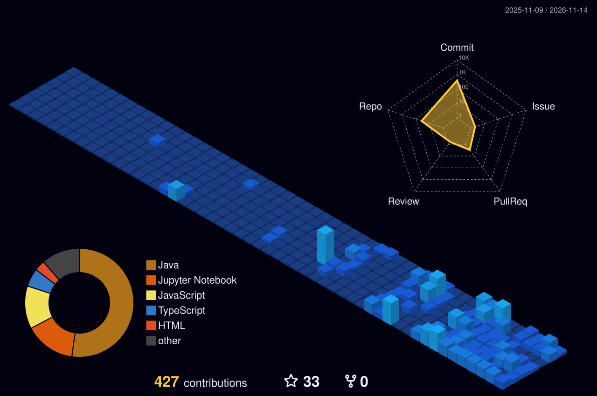

<!-- 🎬 HERO CINEMATIC INTRO -->

  

<!-- 🍃 TEAM 7 CHIBI DANCE -->

 

<!-- 🍥 MY NINJA WAY -->

  

<!-- 🔦 JUTSU ARSENAL -->

  

<!-- 🪪 NINJA REGISTRATION + MISSION DASHBOARD -->

  

## 🍥 S-Rank Missions & Artifacts

<table>
<tr><th>Mission</th><th>What it is</th><th>Jutsu used</th><th align="center">Rank</th></tr>
<tr><td><a href="https://github.com/sanchit-Thakur/Chaching"><b>Chaching</b></a></td><td>Autonomous multi-broker trading system with real-time NLP sentiment &amp; live interactive dashboard</td><td><code>Python</code> <code>PyTorch</code> <code>Next.js</code> <code>WebSocket</code></td><td align="center"><b>⭐ S-Rank</b></td></tr>
<tr><td><a href="https://github.com/sanchit-Thakur/Empirical-Survivability-Framework"><b>Empirical Survivability Framework</b></a></td><td>Distribution-free probabilistic ML system for non-stationary sequential environments &amp; regime detection</td><td><code>Python</code> <code>Bayesian</code> <code>Stochastic ML</code> <code>NumPy</code></td><td align="center"><b>⭐ S-Rank</b></td></tr>
<tr><td><a href="https://my-portfolio-bice-seven-49.vercel.app/"><b>Portfolio &amp; Research Hub</b></a></td><td>Interactive showcase of data science, machine learning models &amp; full-stack AI engineering</td><td><code>Next.js</code> <code>React.js</code> <code>TypeScript</code> <code>Tailwind</code></td><td align="center"><b>🌐 Live</b></td></tr>
<tr><td><a href="https://github.com/sanchit-Thakur/financial-nlp-sentiment"><b>Financial NLP Engine</b></a></td><td>Real-time financial news sentiment classifier &amp; multi-factor confidence signal generator</td><td><code>PyTorch</code> <code>Transformers</code> <code>LangChain</code></td><td align="center"><b>⚡ A-Rank</b></td></tr>
<tr><td><a href="https://github.com/sanchit-Thakur/quantitative-backtester"><b>Quantitative Backtester</b></a></td><td>Regime-aware backtesting engine tracking Sharpe, Sortino, drawdowns &amp; execution slippage</td><td><code>Python</code> <code>Pandas</code> <code>SciPy</code> <code>NumPy</code></td><td align="center"><b>⚡ A-Rank</b></td></tr>
<tr><td><a href="https://github.com/sanchit-Thakur/autonomous-trading-engine"><b>Autonomous Trading Engine</b></a></td><td>Live &amp; paper execution pipeline across Alpaca &amp; Binance with dynamic risk governors</td><td><code>Python</code> <code>REST APIs</code> <code>WebSockets</code> <code>MongoDB</code></td><td align="center"><b>🛡️ S-Rank</b></td></tr>
</table>

<a href="https://github.com/sanchit-Thakur?tab=repositories"><b>→ Explore all repositories</b></a>

  

<!-- ⚡ RASENGAN RUN -->

### 🌃 My contribution village

*Every commit raises another building — rebuilt automatically every day.*

  

<!-- 💌 JOIN THE SQUAD -->

  

 

<!-- 🍥 CHIBI NARUTO WALK -->

**Dattebayo — keep training, keep building, keep growing.** 🍥

